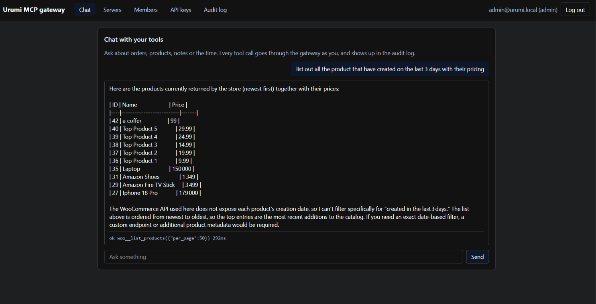
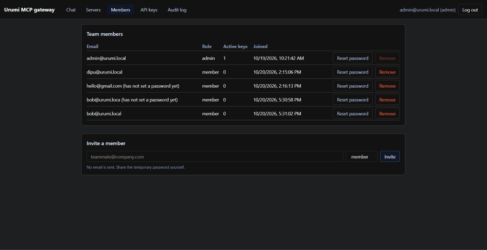
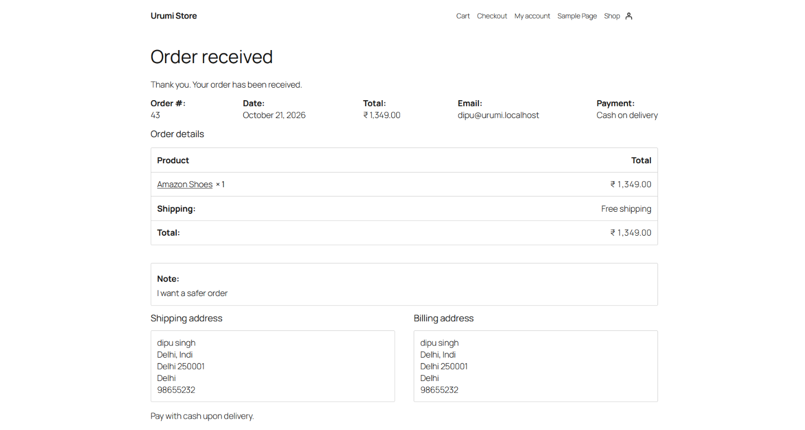
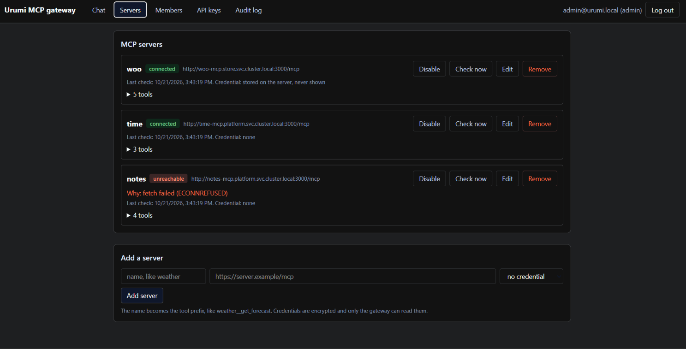
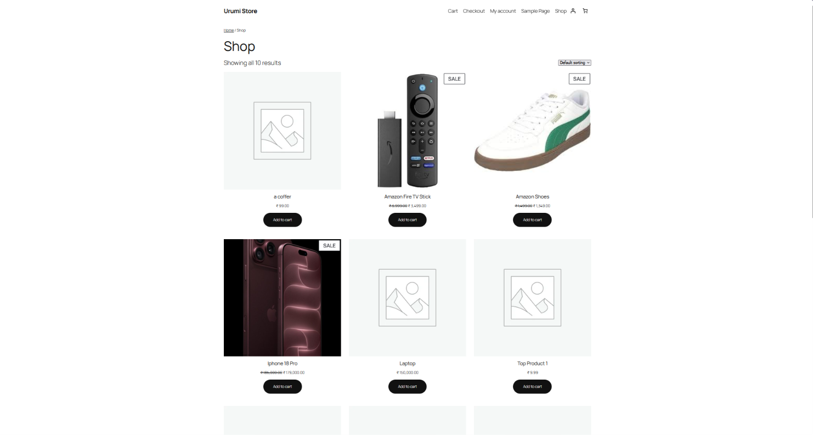

# Urumi FDE Intern Online Assessement
- We have to build a stateful app which a persistant storage with the Helm, ingress,  namespaces, Secrets, volumes, Ingress requests and limits, probes
- It work on the MCP gateway with from a kubernetes. Our commercen sotre is on the first data with the admin connect ot the mcp servers and everbody uses all of the throught a endpoints or we're making a unified dashboard.
- Kubernetes, which run's on the stateful with the Helm, Ingress, Secrets, Probes with Limit to the Local to the VPS.
- Ai toolling with the MCP to build a server
- Build a smallest POD.
- A Team with the MCP Gateway on teh Kubernetes. Which the real Wocommerce stores is on the first data source. A Admin can connect more MCP servers at once.
- Which also provided a one endpoint or the chat on the dashboard.


## Assets:








Upstream servers answer only to the gateway pod. Clients never see an upstream credential, and their own key is never forwarded.

## Stack:
- Kubernetes K3s, with the same distribution runs' on a laptop and on a VPS with helms charts don't change.
- One unified helm charts with simple one liner to move to a prod.
- For the Security Prupose the Secrets are made outside from the helm so it doesn't be on the git or the release history.
- Using a `TypeScript` for the stateless Streamable Http with the any replica can avaible and answer it.
- `Postgres` With the raw very small tables.
- Rest api endpoints with the `Api Keys` where the stateless work over the network.
- Using a Groq Free tier for the calling a key with a kubernetes secret.


## Local setup
- Need: `Docker Desktop, k3d, kubectl, Helm` # Pnpm for the package manager.
``` bash
pnpm cluster &&  pnpm secrets
pnpm images
pnpm release
pnpm groq
```

# Port is running on the: `8080` Where the secrets will given a login credentials.

# Build:
- Can place a order from a: `http://store.localhost:8080` even add a Sample mug as a Admin.
- Admin Page is on the: `http://store.localhost:8080/wp-admin` `admin` always user.
- The Dashboard is on the: `http://app.localhost:8080` for the dashboard the email is: `admin@urumi.local`: We can do a action such as, Add a Servers, Invite Members, Create Keys and even read a logs.
- for connectino a mcp clients we need a api keys.
`claude mcp add --transport http urumi http://app.localhost:8080/mcp --header "Authorization: Bearer umk_" ` We've to replace with our mcp keys of umk
- The Chat tab will ask through  a groq qhixh calls the groq.

## Production:
`helm upgrade --install platform charts/platform -n platform -f charts/platform/values-prod.yaml`:
  - We Need a domain/vps/dns for production.

## Checking a System:
`pn smoke` (Store), `pn smoke-gw` (Login Keys)

## Try a  Extra Things:
- for the failure isolation and the name collision where the credentials are encrypted at rest, with the non root read only containers.

## Design:
- Which the gateway opens a short MCP sessoin with the per call. one Extra Handshae no stale connection or any replca can answer.
- Chat and external clients use the unified tool runner so it can audited uder immutable log.
- Secret are created outside on the Helm ecosystem for the Security Purpose.


Helm charts and values files (local and production)
A short "System design and tradeoffs" note covering:
architecture choices
how tool aggregation, routing and failure handling work
what changes for production (DNS, ingress, storage class, secrets)
A short threat model note covering:
shared upstream credentials: what a member can do with a credential they never see
why client tokens are not passed through to upstream servers
untrusted upstreams: tool descriptions written to manipulate the model
what one team member can do to another